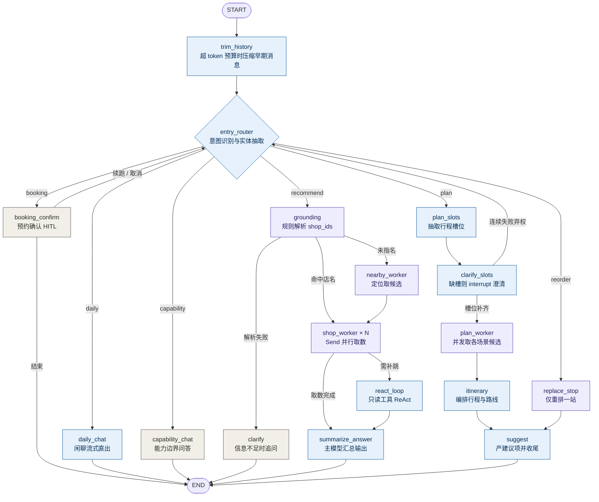

# 本地生活智能问答Agent

## 项目简介

对接本地生活微服务体系的 AI 对话服务，经网关统一鉴权转发，覆盖生活推荐、日常闲聊、能力问答、行程规划与到店预约等场景。基于 LangGraph 做多节点图编排，融合 RAG 检索与业务工具调用，支持流式交互、多轮会话持久化与人工确认（HITL）写路径。

Agent 采用**多节点图编排**而非单模型全流程：入口用轻量模型做意图识别与实体抽取，再按意图分流——闲聊与能力问答走轻链路直接输出，推荐走「Grounding 解析店铺 → 并行 Worker 取数 → 主模型汇总」，行程走「槽位澄清 → 并发取候选 → 编排 → 建议项」。常规推荐链路只调用 2 次大模型。

## 技术栈

Python、FastAPI、LangChain、LangGraph、Chroma、BM25、RRF、Cross-Encoder、Elasticsearch（稀疏检索）、RabbitMQ、Nacos、MySQL、Redis、SSE

## 核心功能

- **意图路由与并行编排**：LangGraph 条件边做主骨架、`Send` 做店铺级并行扇出；流程约束写进代码而非硬塞提示词，链路可控且首字更快。

- **行程规划与槽位澄清**：入口判为规划意图后抽取行程槽位（时间 / 区域 / 人数 / 偏好），缺槽时用 `interrupt()` 挂起追问，补齐后并发取各场景候选并编排站点顺序与路线，最终产出可预约的建议项；澄清连续无效应自动弃权回入口，避免「听不懂就无限追问」。

- **预约写路径 HITL**：下单 / 取消属写操作，由确定性规则短路进入，在确认卡上 `interrupt()` 挂起、人工确认后才落单；写路径的入口判定绝不交给模型，改单次数有上限，避免无限挂起。

- **ReAct 补跳**：仅在「必须看完一批候选才能确定目标」时进入只读工具环，写操作（下单 / 领券 / 支付）永不进环，到步数上限强制收敛并打日志。

- **多方案对比**：用户的软偏好含 ≥2 个维度时，按维度各出一套方案（最便宜 / 评分最高 / 离得最近…）随 SSE 下发；只新增字段，原有 `shops` 完整保留，旧前端不受影响。

- **多店定位与反向偏好**：维度自带方向（支持「最贵 / 最远 / 评分最低」等反向说法），收窄不再是「只取一家」——用户说「评分最高的两家」就收窄到两家，指代说范围（「这三家里」）与明说家数（「哪两家」）分开表达、可同时生效。

- **高精度 RAG 问答**：融合向量 + BM25 / ES 稀疏多路检索与 Cross-Encoder 重排（相对阈值动态裁剪），MQ 增量同步知识库，搭建问答评估体系。

- **长会话历史压缩**：按估算 token 预算触发滚动摘要；压缩失败时保留原文、下轮重试，绝不静默丢失已发生的对话。

- **降级与熔断**：同一类 Worker 连续失败即熔断短路（冷却后自动放行探测），取数超时按**降级**处理、本轮照常出答案；降级文案有单点真源，不散落字面量。

- **运行账本与链路追踪**：一次请求按事件旁路写入 MySQL 三张表（run / LLM 调用 / 工具调用），`X-Trace-Id` 贯穿日志与账本；账本写入绝不阻塞或上抛，可一键关停。

- **会话双存储 + 可观测流式交互**：checkpoint（Redis）里的 messages 只喂模型、会被压缩；`agent_message` 表（MySQL，append-only）才是展示用的完整记录，刷新不丢历史。SSE 支持 `status` 进度骨架、`delta` 逐 token，以及 `suggestions` / `schemes` 结构化事件，结尾补 `message` + `done`。

## Agent 架构



蓝色为调用大模型的节点（`trim_history` 仅在超预算压缩时调用），紫色为纯取数节点，灰色为确定性 / 固定话术节点。

| 节点 | 作用 | 是否调 LLM |
|---|---|---|
| `trim_history` | 上下文超 token 预算时压缩早期消息为滚动摘要并删除原文 | 仅超预算时（轻量模型） |
| `entry_router` | 意图识别 + 实体抽取，一次调用输出结构化路由计划 | 是（轻量模型） |
| `daily_chat` | 日常闲聊，流式直出 | 是（轻量模型） |
| `capability_chat` | 能力边界问答（能做什么），固定话术直出 | 否 |
| `grounding` | 用规则 / 查库把用户表述解析成 `shop_ids`（含指代消解、店名规范化） | 否 |
| `plan_slots` | 计划轨入口：把 query 抽成行程槽位，交给澄清节点判断问不问 | 是（抽槽模型） |
| `clarify_slots` | 缺槽时 `interrupt()` 挂起追问，补齐后继续；连续无效应则弃权回入口 | 是（仅续跑抽槽） |
| `plan_worker` | 并发取各场景候选（自带并发闸门，不用 `Send`） | 否 |
| `itinerary` | 编排行程：站点顺序、路线分段与耗时 | 是（planner 模型） |
| `suggest` | 产可预约建议项并自带收尾输出 | 是（主模型） |
| `replace_stop` | 只重排一站（确定性短路进入） | 否 |
| `booking_confirm` | 预约写路径 HITL：挂起确认 → 下单 / 取消 | 否 |
| `nearby_worker` | 附近找店，取候选池（带重试策略） | 否 |
| `shop_worker` | 取店铺详情、评价、优惠、RAG 片段，只返回紧凑 JSON | 否 |
| `react_loop` | 只读工具 ReAct 补跳（写操作永不进环） | 是（轻量模型决策） |
| `summarize_answer` | 主模型把取数结果整理成自然语言，流式输出 | 是（主模型） |
| `clarify` | 信息不足时向用户追问 | 否 |

**关键设计**

- 常规推荐链路**只调 2 次 LLM**（入口 + 汇总），中间全是数据节点，对比旧版 5–8 次工具循环；
- 单店 / 多店由 `len(shop_ids)` 推导，它是事实不是意图，不额外占用一次模型调用；
- `focus_shops` 入 State，解决「这家 / 第二家 / 它 / 最后两家 / 前两家」的跨轮指代：入口模型抽出下标（支持负数倒数、复数区间），抽不到再回退规则兜底；
- `worker_outputs` 用完即清（可序列化字符串哨兵 `__CLEAR__`），避免被 checkpoint 带入下一轮导致上下文膨胀；
- 两个 `interrupt()` 点（槽位澄清 / 预约确认）互不重叠，且都只在纯函数之后挂起，保证重放不产生副作用。

## 历史压缩

长会话直接硬截断会丢上下文，全量保留又撑爆 token。这里的做法是**截断前先语义压缩**，触发口径只有一条——**估算 token 预算**（不再按轮数）：

1. 上下文估算超过 `AGENT_HISTORY_TOKEN_BUDGET`（默认 3000 估算 token）时，取最早一批待删消息；
2. 轻量模型结合已有摘要压缩成新的 running summary，写入 State 的 `history_summary`；
3. 用 `RemoveMessage` 删除原文，摘要再注入 `entry_router` / `daily_chat` / `summarize_answer` 的提示词，弥补被删掉的早期上下文；
4. 压缩调用异常时**保留原文不删除**、下轮重试，宁可暂时多占 token，也绝不静默丢失已发生的对话。

token 估算默认走零依赖的 CJK 口径（CJK ≈ 1 token/字、非 CJK ≈ 1/4 字符，可用 `AGENT_HISTORY_ESTIMATE_FACTOR` 校准）；置 `USE_TIKTOKEN_ESTIMATE=true` 可切换 tiktoken 真实计数（需装可选依赖，不可用时安全回落）。同一条预算也决定 `daily_chat` 只注入最近多少历史。

## 服务发现（Nacos）

出站调用（shop / blog / voucher / search）的地址解析优先级：

1. `.env` 中显式配置的 `SHOP_SERVICE_URL` / `BLOG_SERVICE_URL` / `VOUCHER_SERVICE_URL` / `SEARCH_SERVICE_URL` —— **优先**，这是使用者已验证可达的地址；
2. 未配置时，回落到 Nacos 命名服务定时（默认 10s）拉取的**健康实例**，自带负载均衡与故障转移；
3. 都拿不到则返回空，由调用方按原有逻辑处理（取数失败按降级口径出答案）。

`NACOS_SERVER_ADDRS` 未配置时服务发现静默不启用，后台线程不会启动，最坏情况等价于写死地址。

> 之所以让静态地址优先：Spring Cloud 默认以机器局域网 IP 注册到 Nacos，该地址在 agent 运行时未必可达，动态优先反而会出现「Nacos 有实例却连不通」。

## 环境要求

Python ≥ 3.13，包管理器使用 [uv](https://docs.astral.sh/uv/)。另需自备 MySQL 与 Redis：

- **MySQL**（独立库 `hmdp_agent`，与 Java 侧同一实例）：会话元数据、`agent_message` 消息表与运行账本三张表使用。应用**只校验表与列是否存在、不建表**，缺失即启动失败，故部署前需先执行建表脚本；只想停写账本而不删表时设 `AGENT_LEDGER_ENABLED=false`。
- **Redis**：checkpoint 默认后端（进程外共享，多实例同 `thread_id` 都能读到历史）；无 Redis 时可回退 `AGENT_CHECKPOINT_BACKEND=sqlite`（本地调试用，多实例各存各）。

## 快速开始

```bash
uv sync                 # 安装依赖
cp .env.example .env    # 填入模型 API Key、各服务地址与 MySQL / Redis 连接
uv run python -m app.main
```

服务默认监听 `8001` 端口，可通过 `.env` 中的 `AGENT_HOST` / `AGENT_PORT` 修改。如需 LangGraph 调试面板，可改用 `uv run langgraph dev`。

## 目录结构

```
agent-service/
├── app/
│   ├── main.py                 # FastAPI 入口：路由注册、启动校验（表/列 fail-fast）、Nacos 注册、服务发现启停
│   ├── service_discovery.py    # Nacos 服务发现（后台刷新 + 本地缓存 + 静态地址优先）
│   ├── nacos_registry.py       # 本服务实例注册到 Nacos
│   ├── agents/
│   │   ├── graph/              # LangGraph 图
│   │   │   ├── state.py        # 最小状态集
│   │   │   ├── llm.py          # 主 / 轻量 / 抽槽 / planner 模型工厂 + fallback 链
│   │   │   ├── prompts.py      # 拆分后的短提示词
│   │   │   ├── nodes.py        # 各节点实现（路由、取数、行程、预约、压缩）
│   │   │   ├── workflow.py     # build_graph：条件边骨架 + Send 扇出 + HITL 分支
│   │   │   ├── plan_slots.py   # 行程槽位规格（必填槽 / 候选 / 校验，纯函数）
│   │   │   ├── token_budget.py # 历史 token 估算与压缩切分规则
│   │   │   ├── degrade.py      # 降级文案单点真源
│   │   │   └── ledger_callback.py # LangChain 回调 → 账本事件
│   │   ├── checkpoint/         # checkpoint 后端（Redis 默认 / SQLite 回退）
│   │   ├── ledger.py           # 运行账本（MySQL 三表，旁路写入）
│   │   ├── hmdp_agent.py       # 对外门面：generate_sse / get_messages / clear_messages
│   │   ├── hmdp_tools.py       # Java 微服务调用封装（fetch_* 纯函数）
│   │   ├── hmdp_mcp.py         # MCP 工具
│   │   └── hmdp_metrics.py     # 全链路指标采集
│   ├── rag/                    # 检索：Chroma + BM25 + ES 稀疏 + 重排 + MQ 增量同步
│   ├── api/v1/                 # HTTP 接口：对话、会话、运行账本、OSS 预签名
│   ├── models/                 # 数据模型（会话 / 消息 / 请求响应）
│   └── common/                 # 配置读取、MySQL、链路追踪、日志
├── db/                         # 运行期数据（SQLite checkpoint 等，已 gitignore）
└── langgraph.json              # LangGraph 调试面板配置
```

## 主要配置项

完整列表见 `.env.example`，以下为架构相关项：

| 变量 | 默认值 | 说明 |
|---|---|---|
| `AGENT_MODEL` / `AGENT_LIGHT_MODEL` | 无（**必填**） | 主模型 / 轻量模型，漏配即启动失败，不在代码里静默回退 |
| `AGENT_SLOT_MODEL` | 空 = 跟主模型 | 抽槽（SlotFill）专用模型，不在热路径，可留主模型 |
| `AGENT_PLANNER_MODEL` | 空 = 跟轻量模型 | 计划轨编排模型，不支持结构化输出时回落规则兜底 |
| `AGENT_FALLBACK_MODEL` / `AGENT_FALLBACK_LIGHT_MODEL` | 空 | 主 / 轻量模型的备用模型，留空则退回单端点 |
| `AGENT_ENABLE_THINKING` | `false` | 模型思考模式；开启后首字可 10s+，默认关 |
| `AGENT_HISTORY_TOKEN_BUDGET` | `3000` | 历史压缩触发与上下文注入的**统一 token 口径** |
| `AGENT_HISTORY_ESTIMATE_FACTOR` | `1.0` | CJK 估算 token 的校准系数 |
| `AGENT_MAX_FANOUT` | `8` | 并行取数上限（任务数 × 店铺数） |
| `AGENT_WORKER_TIMEOUT` | `12` | 单 Worker 取数超时（超时 = 降级，不是失败） |
| `AGENT_FANOUT_FAIL_THRESHOLD` / `_COOLDOWN` | `3` / `30` | 熔断阈值与冷却窗口（秒） |
| `AGENT_MAX_SHOPS` | `3` | 单次并行处理的店铺数上限 |
| `AGENT_NEARBY_TOP` / `AGENT_NEARBY_MAX_TYPES` | `5` / `3` | 「附近找店」候选数与最多解析的类型数 |
| `AGENT_MAX_TARGET_INDICES` | `5` | 指代下标与「明说家数」的截断上限（防「前 100 家」拉爆查询） |
| `AGENT_REACT_MAX_STEPS` | `6` | ReAct 补跳最大步数 |
| `AGENT_PLAN_ENABLED` | `false` | 行程规划轨总开关（关闭时判据照跑、一律回落 recommend） |
| `AGENT_MULTI_SCHEME_ENABLED` | `true` | 软偏好多维度时是否出多套方案 |
| `AGENT_CHECKPOINT_BACKEND` | `redis` | checkpoint 后端：`redis`（默认）/ `sqlite` |
| `AGENT_LEDGER_ENABLED` | `true` | 运行账本写入开关（关掉只停写、不删表） |
| `AGENT_TRACE_ENABLED` / `AGENT_TRACE_HEADER` | `true` / `X-Trace-Id` | 链路追踪开关与请求头名 |
| `AGENT_SSE_STATUS` / `AGENT_SSE_DELTA` | `true` / `true` | 是否推进度事件 / 是否逐 token 推送 |
| `SHOP/BLOG/VOUCHER/SEARCH_SERVICE_URL` | `http://localhost:808x` | Java 微服务静态地址，优先使用；留空则走 Nacos 发现 |
| `NACOS_SERVER_ADDRS` | 无 | Nacos 地址，留空则不启用服务发现 |

## 关联项目

- [ppl-cloud](https://github.com/wuzang213/ppl-cloud)：本地生活微服务后端。本项目的业务工具调用依赖其中的店铺、博客、优惠券、搜索服务，需先启动并通过网关暴露接口。

> 本项目与 Nacos 的关系是**双向的**：启动时把自身注册为 `agent-service` 供网关以 `lb://agent-service` 转发；同时可读取 Nacos 上 Java 服务的健康实例用于出站调用。但它**不读取任何配置 DataId**，自身配置全部来自 `.env`。所需的 Nacos 共享配置见 ppl-cloud 仓库的 `nacos-config/` 目录。
